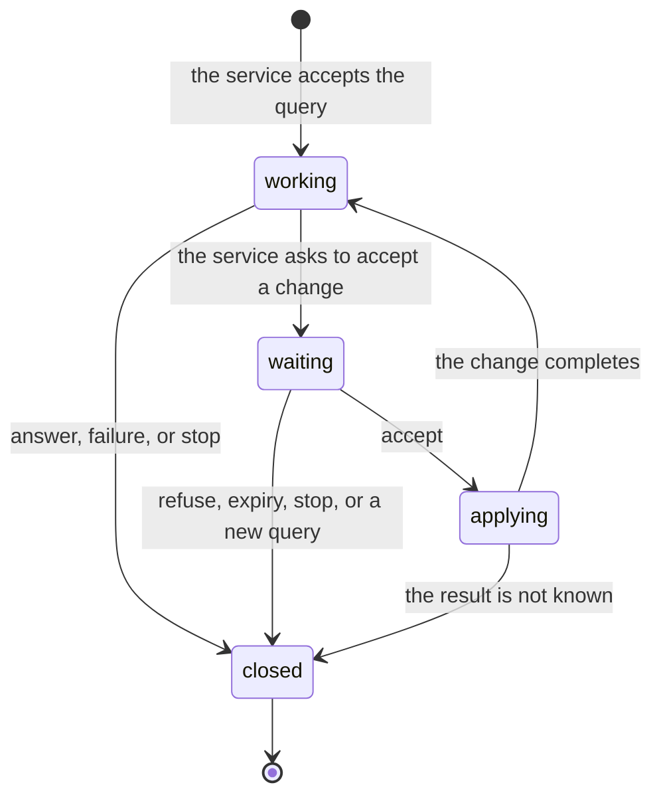

# Query

**Unstable.** This document changes soon ([04-versioning.md](04-versioning.md#unstable-parts)).

The user can ask the service a question in plain language. The service answers on the stream ([05-stream.md](05-stream.md)). Before the service changes data for a query, it asks the user to accept the change. The query is optional. A service without it works as without this document.

The contract states only how Custos and the service exchange a query. How the service makes the answer is not part of the contract.

## Discovery

The optional member `query_endpoint` of the discovery document ([01-discovery.md](01-discovery.md)) announces the query:

| Member | Type | Content |
|---|---|---|
| `query_endpoint` | string (URL) | The endpoint of the query. |

- The URL obeys the HTTPS rule of the discovery document.
- A service with `query_endpoint` MUST also have `stream_endpoint`. Custos MUST ignore `query_endpoint` when `stream_endpoint` is not present.

## Client

A query belongs to one client: one login of Custos. The service identifies the client from the access token, for example by the claim `sid` of the session.

- The service MUST send the messages of a query only to the streams of its client.
- Only the client of a query can send an [action](#actions) for it.
- A query and an action need no open stream. Custos gets the messages when its stream opens again ([Stream open](#stream-open)).

## Send a query

```http
POST {query_endpoint}
Authorization: Bearer {access_token}
Content-Type: application/json

{"reference":"0b7e5c1a-9f42-4c1e-8d43-6a1f2e9c7b10","text":"How many rifles are in the seaport?","width":40,"lines":8}
```

The schema of the body is [schemas/query.schema.json](schemas/query.schema.json).

| Member | Type | Required | Content |
|---|---|---|---|
| `reference` | string | yes | The reference of the query. Custos makes it: 8 to 64 letters, digits, or `-`. Custos SHOULD use a random UUID. |
| `text` | string | yes | The question of the user, 1 to 500 characters. |
| `width` | integer | yes | The number of characters in one line of the area where Custos shows the answer, 20 to 200. |
| `lines` | integer | yes | The number of lines of that area, 1 to 50. |
| `new_conversation` | boolean | no | `true` starts the query with no context from earlier queries. The default is `false`. |

- A second send with the reference of a query is the same query. The service gives the same response as to the first send, with the current state. It does not start a second query.
- The service SHOULD respond in 1 second. It MUST NOT wait for the answer before it responds.
- The service uses `width` and `lines` to give an answer that fits the area.

### Conversation

A query of a client can continue the conversation of the earlier queries of that client. The service then uses those queries and their answers as context. The service decides how long a conversation stays. A query with `new_conversation` `true` starts a new conversation.

### Open query

A query is open until its [closing message](#closing-causes).

- A client has at most one open query. A new query of the client replaces its open query: the service closes the open query with the cause `replaced`, then starts the new query. When the open query is in the state `applying`, the service completes the change first.
- A user has at most one open query. While a client of the user has an open query, the service refuses a query of each other client of that user with `409`.

## Actions

```http
POST {query_endpoint}
Authorization: Bearer {access_token}
Content-Type: application/json

{"reference":"0b7e5c1a-9f42-4c1e-8d43-6a1f2e9c7b10","action":"accept"}
```

The schema of the body is [schemas/query-action.schema.json](schemas/query-action.schema.json). The body of an action has `action` and no `text`.

| Action | Permitted in the state | Result |
|---|---|---|
| `accept` | `waiting` | The user accepts the change. The query goes to `applying`. |
| `refuse` | `waiting` | The user refuses the change. The query closes with the cause `refused`. |
| `stop` | `working`, `waiting` | The user stops the query. The query closes with the cause `stopped`. |

- The service MUST NOT change data for a query before it gets `accept` for that change.
- One action wins. A second equal action gets the same response as the first. A different action after it gets `409`.
- The service applies the change with the access token of the `accept` request. Thus the user must have the access for the change at that time.

## Responses

The response to a query is `202`. The response to an action is `200`. The body of both is the state document ([schemas/query-state.schema.json](schemas/query-state.schema.json)):

| Member | Type | Required | Content |
|---|---|---|---|
| `reference` | string | yes | The reference of the query. |
| `state` | string | yes | The current [state](#states). |
| `deadline` | string (RFC 3339) | no | As in the [message](#messages). |
| `cause` | string | no | As in the [message](#messages). |

```json
{
  "reference": "0b7e5c1a-9f42-4c1e-8d43-6a1f2e9c7b10",
  "state": "working",
  "deadline": "2026-11-25T20:00:05Z"
}
```

| Status | Meaning | Action of Custos |
|---|---|---|
| `200` | The service accepted the action. | Show the state. |
| `202` | The service accepted the query. | Show the state. Show the messages of the query from the stream. |
| `400` | The body is not valid. | Report the error. Do not send the same body again. |
| `401` | The token is missing or not valid. | Do the challenge steps in [02-authentication.md](02-authentication.md#challenge). |
| `403` | The service answers no query of this user, for example because the token names no session. | Report the error. |
| `404` | The endpoint does not exist, or the client has no query with this reference. | For a query, get the discovery document again. For an action, remove the query. |
| `409` | The service refuses the query: another client of the user has an open query. Or the service refuses the action: the state does not permit it, or a different action won. | Report the error. After an action, show the state from the stream. |
| `429` | The user sent too many queries. The response MUST have a `Retry-After` header. | Report the error with the time in `Retry-After`. |
| `5xx` | An error in the service. | Report the error. Custos MAY send the same body again: the reference makes it safe. |

Each error response has the type `application/problem+json`. Custos SHOULD show its `title` and `detail` to the user, because they give the cause of a refusal.

## Messages

The service sends each message of a query on the stream, with the kind `query` ([05-stream.md](05-stream.md#message)). Each message replaces the earlier message of the query, because it has the same `reference`. The schema is [schemas/message.schema.json](schemas/message.schema.json).

| Member | Type | Required | Content |
|---|---|---|---|
| `kind` | string | yes | `query`. |
| `reference` | string | yes | The reference of the query. |
| `state` | string | yes | The [state](#states) of the query. |
| `text` | string | no | The text of the state, 2000 characters at most. See [States](#states). |
| `deadline` | string (RFC 3339) | no | In each state except `closed`: the service sends the next message of the query before this time. In the state `waiting`, it is also the end of the question. |
| `cause` | string | no | In the state `closed`: the [cause](#closing-causes) of the end. |
| `source` | string | no | As in [05-stream.md](05-stream.md#message). |

- A message in each state except `closed` MUST have `deadline`.
- When the deadline goes by and Custos has no new message of the query, the service is not in contact. Custos SHOULD show this to the user.
- `text` can hold line breaks.

### States



| State | Meaning | `text` |
|---|---|---|
| `working` | The service works on the query. | The current step, for example `Custos: Find items`. It is optional. |
| `waiting` | The service waits for `accept` or `refuse`. | The question to the user. It is required. |
| `applying` | The service changes the data. The user cannot stop it. | The current step. It is optional. |
| `closed` | The query ended. | The answer, or the cause of the end. It is required. |

### Closing causes

Each query ends with exactly one message in the state `closed`. After it, the service sends no other message of the query.

| Cause | Meaning |
|---|---|
| `answer` | The service answered. `text` is the answer. |
| `refused` | The user refused the change. |
| `expired` | The question ended at its deadline, with no action. |
| `replaced` | A new query of the client replaced this query. |
| `stopped` | The user stopped the query. |
| `failed` | The service could not complete the query. |
| `interrupted` | The service stopped while it worked on the query, for example at a restart. |
| `result_unknown` | The service stopped or failed while it changed the data. The change can be complete, partly complete, or not done. |

The set of causes is open. Custos MUST show a closing message with a cause that it does not know as the cause `failed`.

### Stream open

When a stream of the client opens, the service first sends its position ([05-stream.md](05-stream.md#position)). Then it sends the last message of the open query of the client, if the client has one, with the `id` of that position. Then it sends the messages after the position.

Thus Custos shows the state of the open query after each connection, also when the position is too old for a replay.

## Example

The user asks a question, and the service asks to accept a change. The stream of the client gets these messages, each in its own event:

```json
{"kind":"query","reference":"0b7e5c1a-9f42-4c1e-8d43-6a1f2e9c7b10","state":"working","deadline":"2026-11-25T20:00:05Z","source":"optio"}
{"kind":"query","reference":"0b7e5c1a-9f42-4c1e-8d43-6a1f2e9c7b10","state":"working","text":"Custos: Find structures","deadline":"2026-11-25T20:00:12Z","source":"optio"}
{"kind":"query","reference":"0b7e5c1a-9f42-4c1e-8d43-6a1f2e9c7b10","state":"waiting","text":"Set Label? \"Main Depot\"","deadline":"2026-11-25T20:01:10Z","source":"optio"}
```

Custos sends `accept`. The service changes the label and answers:

```json
{"kind":"query","reference":"0b7e5c1a-9f42-4c1e-8d43-6a1f2e9c7b10","state":"applying","text":"Custos: Set structure label","deadline":"2026-11-25T20:00:31Z","source":"optio"}
{"kind":"query","reference":"0b7e5c1a-9f42-4c1e-8d43-6a1f2e9c7b10","state":"working","deadline":"2026-11-25T20:00:40Z","source":"optio"}
{"kind":"query","reference":"0b7e5c1a-9f42-4c1e-8d43-6a1f2e9c7b10","state":"closed","cause":"answer","text":"The seaport is now labeled \"Main Depot\".","source":"optio"}
```
